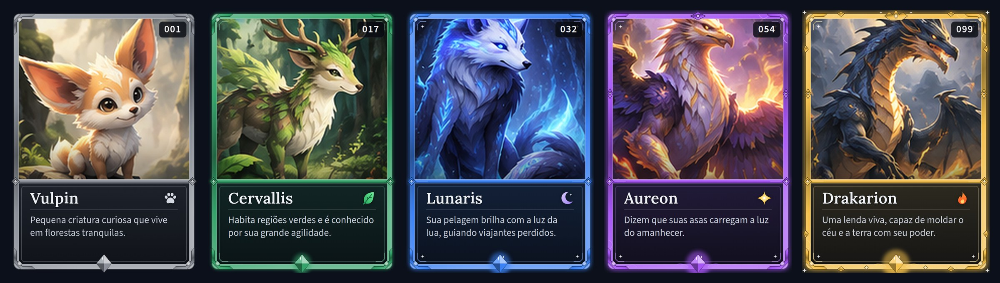
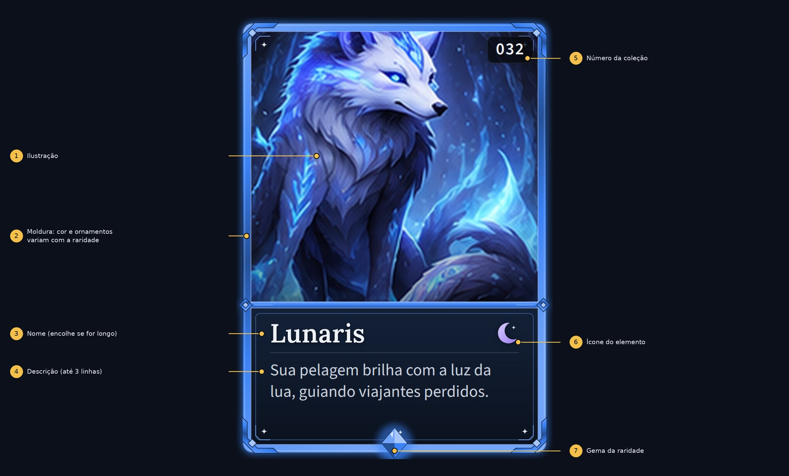
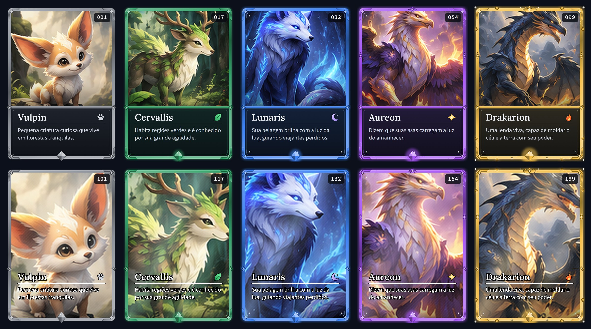
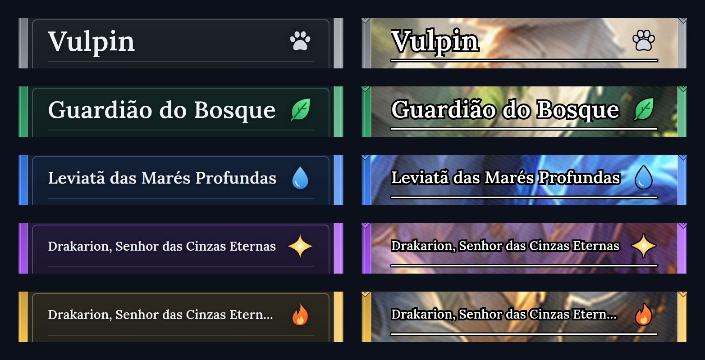
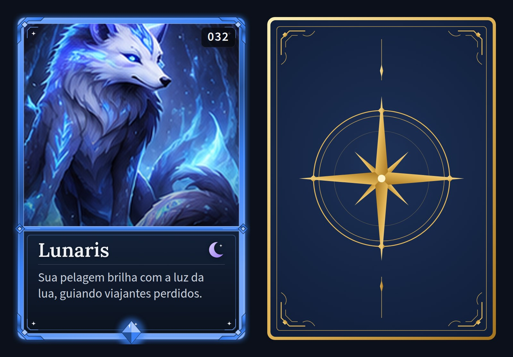
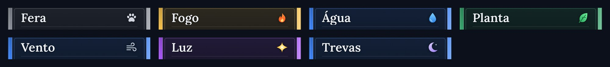
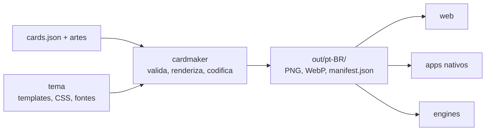

# Card Maker Go

[](https://github.com/Bryant-Anjos/card-maker-go/actions/workflows/ci.yml)
[](LICENSE)
[](https://bryant-anjos.github.io/card-maker-go/)

**Gerador de cartas colecionáveis a partir de dados.** Você entrega os dados das cartas, as ilustrações e um
tema; ele gera as imagens finais (PNG ou WebP) e um `manifest.json` que **qualquer plataforma** consegue usar:
web, apps nativos, engines de jogo.



## Por que existe

Reescrever a composição das cartas a cada plataforma é trabalho dobrado e gera visuais diferentes. Aqui a
composição acontece **uma vez**, no build do conteúdo; os projetos só leem o `manifest.json` e carregam
imagens. Para mudar o visual, edita-se o tema e roda-se o build de novo.

O programa é **agnóstico**: não conhece raridades, elementos nem artes. Tudo isso vem do tema e dos seus dados,
então o mesmo código serve a qualquer jogo de cartas.

## Destaques

- **Visual em HTML e CSS**: o tema é um conjunto de arquivos comuns (template, CSS, fontes, SVGs) renderizados
  em um Chromium headless. Trocar o visual é editar o tema.
- **Raridades, elementos e variantes são dados do tema**, não código. Há até uma variante *full art* pronta.
- **Várias escalas e formatos**: 1x, 2x, 3x em PNG ou WebP (cerca de 11x menor que o PNG, visualmente idêntico).
- **Multi-idioma**: textos por idioma, com fallback.
- **Build incremental**: só renderiza o que mudou (cache por hash).
- **Valida tudo antes de renderizar**, e reporta todos os erros de uma vez, com o caminho do campo.
- **API HTTP opcional** para gerar uma carta sob demanda, e **imagem Docker** pronta.
- **Contrato formal**: JSON Schemas para quem consome a saída sem usar Go.

## Veja o que ele gera

**Anatomia de uma carta** do tema `default`:



**Variante full art**, para qualquer raridade (em cima o layout padrão, embaixo o full art):



**Nomes longos** encolhem sozinhos para caber (padrão à esquerda, full art à direita):



<details>
<summary>Frente e verso, e os elementos</summary>





</details>

> As ilustrações das cartas de exemplo foram recortadas da imagem de referência do projeto
> ([`docs/reference`](docs/reference/card-design-reference.png)) e servem só para demonstração. As imagens
> acima são geradas pela própria ferramenta (`make docs-images`), não desenhadas à mão.

## Como funciona



## Início rápido

Requisitos: **Go** (versão em `.tool-versions`) e um **navegador Chromium** (`chromium`, `google-chrome`,
`brave-browser`...; ou use a [imagem Docker](docs/DOCKER.md), que já o inclui).

```bash
make build                                   # gera bin/cardmaker e bin/cardmaker-server

# confere dados, tema e artes sem renderizar nada
bin/cardmaker validate -cards testdata/showcase/cards.json -theme themes/default

# gera as imagens + manifest.json em out/pt-BR/
bin/cardmaker build -cards testdata/showcase/cards.json -theme themes/default \
  -out out -scales 1,2 -formats png,webp
```

Uma carta nos dados (`cards.json`) é assim:

```json
{ "id": "lunaris", "number": 32, "rarity": "rare", "element": "dark",
  "name": { "pt-BR": "Lunaris" },
  "description": { "pt-BR": "Sua pelagem brilha com a luz da lua, guiando viajantes perdidos." },
  "art": "art/lunaris.png" }
```

E o `manifest.json` que sai dele (resumido) traz textos já resolvidos e o caminho de cada imagem:

```json
{ "schemaVersion": 1, "theme": "default", "locale": "pt-BR",
  "cards": [ { "id": "lunaris", "name": "Lunaris", "rarity": "rare",
    "images": [ { "scale": 2, "format": "webp", "path": "cards/lunaris@2x.webp", "width": 1500, "height": 2100 } ] } ] }
```

Para **gerar uma carta sob demanda** por HTTP:

```bash
CARDMAKER_API_TOKEN=um-token bin/cardmaker-server -themes themes
```

Se não houver navegador à mão, `-renderer fake` gera retângulos coloridos e permite experimentar o fluxo todo.

## Documentação

A documentação está publicada em **<https://bryant-anjos.github.io/card-maker-go/>** (com busca) e também em
[`docs/`](docs/README.md). Por onde começar:

| Quero... | Leia |
|---|---|
| preparar meus dados e entender o formato | [Contrato de dados](docs/CONTRATO.md) |
| usar as cartas no meu app, site ou jogo | [Guia de integração](docs/INTEGRACAO.md) |
| criar ou alterar o visual | [Guia de temas](docs/TEMAS.md) |
| ver todas as flags | [Referência da CLI](docs/CLI.md) |
| gerar cartas por HTTP | [API](docs/API.md) e [Docker](docs/DOCKER.md) |
| entender ou mexer no código | [Arquitetura](docs/ARQUITETURA.md) e [Desenvolvimento](docs/DESENVOLVIMENTO.md) |
| resolver um erro | [Solução de problemas](docs/SOLUCAO-DE-PROBLEMAS.md) |

## Estado do projeto

Todas as fases do [plano](docs/PLAN.md) estão concluídas: contrato de dados, validação, temas, renderer
com Chromium, build incremental, API HTTP, Docker, WebP com compressão, variante full art e ajuste automático
de fonte. Os testes passam (cerca de 92% de cobertura, sem condições de corrida) e incluem regressão visual.

Limitações conhecidas: a API não tem limite de taxa por cliente nem CORS (use um proxy na frente); arquivos de
cartas removidas não são apagados da saída; o tema `default` usa a proporção 5:7, mais larga que a da imagem de
referência. Veja o [plano](docs/PLAN.md) e a [API](docs/API.md) para o detalhe.

## Licença

O código é distribuído sob a [licença MIT](LICENSE). As fontes do tema `default` (Lora e Source Sans 3) são
livres (OFL) e trazem as licenças em `themes/default/fonts/`. As ilustrações dos exemplos servem apenas para
demonstração (veja a nota na seção "Veja o que ele gera").

## Desenvolvimento

```bash
make check    # vet + testes (inclui a verificação da documentação)
make cover    # cobertura
```

Contribuições seguem TDD e mantêm a documentação em dia na mesma mudança; as regras estão em
[Desenvolvimento](docs/DESENVOLVIMENTO.md#documentação-viva).
