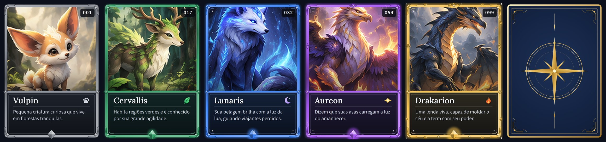

# Card Maker Go

Gerador de cartas agnóstico: recebe dados, imagens e um tema e gera as imagens finais das cartas
(PNG/WebP) mais um `manifest.json`, para serem usadas por qualquer plataforma.



Documentação:

- [docs/CONTRATO.md](docs/CONTRATO.md): formato das cartas, do tema e do manifest (o que outros projetos precisam saber)
- [docs/INTEGRACAO.md](docs/INTEGRACAO.md): como consumir a saída na web, em apps nativos, engines e Go
- [docs/API.md](docs/API.md): servidor HTTP para gerar cartas sob demanda (`cardmaker-server`)
- [docs/DOCKER.md](docs/DOCKER.md): imagem Docker (CLI e API), compose e o sandbox do Chromium
- [docs/TEMAS.md](docs/TEMAS.md): como criar ou alterar um tema (dados do template, boas práticas, tema `default`)
- [docs/PLAN.md](docs/PLAN.md): plano de implementação e progresso
- [Design de referência](docs/reference/card-design-reference.png)

## Uso

```bash
# checa dados, tema e artes sem renderizar
cardmaker validate -cards testdata/showcase/cards.json -theme themes/default

# gera as imagens + manifest.json em out/pt-BR/
cardmaker build -cards testdata/showcase/cards.json -theme themes/default \
  -out out -locale pt-BR -scales 1,2 -formats png,webp
```

Para gerar cartas sob demanda por HTTP, use o `cardmaker-server` (veja [docs/API.md](docs/API.md)):

```bash
CARDMAKER_API_TOKEN=um-token bin/cardmaker-server -themes themes
```

A renderização usa um navegador Chromium headless (ou use a [imagem Docker](docs/DOCKER.md), que já o inclui). Ele é procurado em `-chrome <caminho>`, depois na
variável `CARDMAKER_CHROME` e depois no `PATH` (`chrome-headless-shell`, `chromium`, `google-chrome`,
`brave-browser`, ...). Reexecutar o `build` só renderiza o que mudou (`-force` ignora o cache);
`-renderer fake` gera retângulos coloridos sem navegador, útil para testar o pipeline.

O WebP sai com perda por padrão, na qualidade 90 (cerca de 11x menor que o PNG, visualmente idêntico); use
`-webp-quality 100` para WebP sem perda ou um valor menor para arquivos ainda menores.

`testdata/showcase/` usa as artes recortadas do design de referência, para revisão visual;
`testdata/cards/` usa artes placeholder, para os testes.

## Desenvolvimento

```bash
make check   # go vet + go test
make build   # gera bin/cardmaker e bin/cardmaker-server
```

Requer Go (veja `.tool-versions`) e um Chrome/Chromium para a renderização; os testes que precisam do
navegador são pulados quando nenhum é encontrado. Para os testes de regressão visual serem exatos, use o
mesmo navegador que gerou os goldens (veja `testdata/golden/default/RENDERER` e [docs/TEMAS.md](docs/TEMAS.md)).

```bash
make golden        # regrava as golden images após uma mudança visual intencional
make theme-frames  # regenera os ornamentos por raridade do tema default
```
