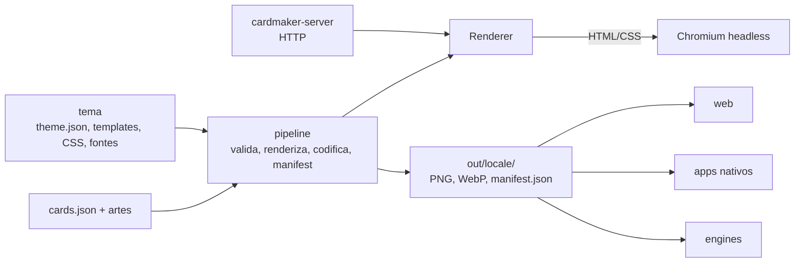
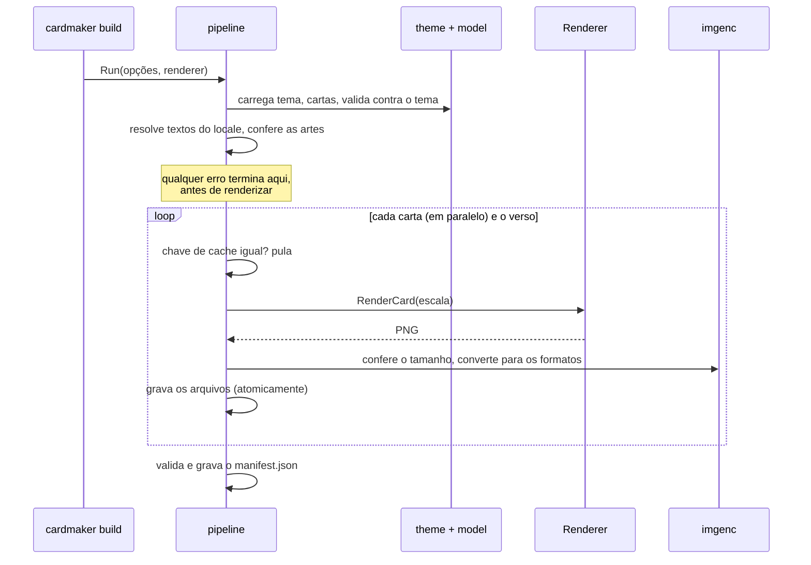

# Arquitetura

Como o código está organizado, como os dados fluem e por que as decisões principais foram tomadas. Para o
formato dos dados, veja o [contrato](CONTRATO.md); para criar temas, o [guia de temas](TEMAS.md).

## Visão geral

O Card Maker Go é um **programa de build de assets**: ele lê dados de cartas, ilustrações e um tema, e gera
as imagens finais mais um `manifest.json`. Os projetos que usam as cartas (web, nativo, engines) só leem essa
saída, então a composição da carta existe **em um lugar só**.

O programa **não conhece raridades, elementos nem artes**: tudo isso vem do tema e dos dados. Por isso o mesmo
código serve a qualquer jogo de cartas.

## Mapa de pacotes

| Diretório | Responsabilidade | Peças principais |
|---|---|---|
| `cmd/cardmaker` | CLI: `version`, `validate`, `build`. Só interpreta flags e chama o pipeline. | `run` |
| `cmd/cardmaker-server` | Executável da API HTTP: flags, token, desligamento gracioso. | `run`, `isLoopbackAddress` |
| `pkg/cardmaker` | Versão do programa. | `Version` |
| `pkg/cardmaker/model` | **Contrato de dados**: cartas, tema, manifest. Parsing estrito e validação que reporta todos os erros com o caminho do campo. | `Card`, `CardSet`, `Theme`, `Manifest`, `LocalizedText`, `ParseCardSet`, `ValidateAgainst` |
| `pkg/cardmaker/theme` | Carrega uma pasta de tema e confere que todos os arquivos citados existem. | `Load`, `LoadDir`, `Theme` (definição + `fs.FS`) |
| `pkg/cardmaker/i18n` | Resolve nome e descrição para um idioma, com fallback (`en-US` → `en` → padrão). | `Resolver`, `ResolvedCard` |
| `pkg/cardmaker/render` | **Interface `Renderer`**: como uma carta vira PNG. Inclui o renderer falso para testes. | `Renderer`, `CardRequest`, `BackRequest`, `Fake` |
| `pkg/cardmaker/render/chrome` | Renderer real: executa o template do tema, serve a página e a arte a um Chromium headless e captura PNG. | `Renderer`, `New`, `FindBrowser`, `CardData` |
| `pkg/cardmaker/renderers` | Escolhe o renderer pelo nome (`chrome` ou `fake`); compartilhado pelos dois executáveis. | `Open` |
| `pkg/cardmaker/imgenc` | Converte o PNG do renderer nos formatos de saída (PNG, WebP com controle de qualidade) e confere o tamanho. | `Encode`, `EncodeAll`, `CheckPNGSize` |
| `pkg/cardmaker/pipeline` | **Build em lote**: valida tudo antes, renderiza em paralelo, codifica, cache por hash, escreve o manifest. | `Run`, `Validate`, `Options` |
| `pkg/cardmaker/server` | Camada HTTP fina sobre o mesmo núcleo: rotas, autenticação, limites, fila de renderização. | `New`, `Config`, `LoadThemes` |
| `schema` | JSON Schemas do contrato, embutidos no binário (`embed`). | `FS` |
| `themes/default` | O tema de exemplo, que reproduz o [design de referência](reference/card-design-reference.png). | `theme.json`, templates, `style.css`, `fit.js`, ícones, molduras, fontes |
| `internal/docscheck` | Testes que mantêm a documentação em dia (veja [DESENVOLVIMENTO.md](DESENVOLVIMENTO.md#documentação-viva)). | `SourceHash` |
| `internal/devtools/docsourcehash` | Imprime a impressão digital das fontes das imagens da documentação. | |
| `internal/devtools/placeholderart` | Gera as artes de teste (degradês) de `testdata/cards/art`. | |

Ferramentas em Python (não fazem parte do binário): `internal/devtools/docimages` (imagens da documentação) e
`internal/devtools/framegen` (ornamentos por raridade do tema `default`).

Dependências entre pacotes (setas = "usa"): `cmd/*` → `pipeline`/`server` → `render`, `theme`, `i18n`, `imgenc`
→ `model`. O `model` não depende de nenhum outro pacote do projeto, e só `render/chrome` conhece o navegador.

## Fluxo de um build

## Fluxo de uma requisição à API

`POST /v1/render` → autenticação (token) → limites de corpo e de parâmetros → tema pelo nome (mapa carregado
na partida, **nunca um caminho vindo do cliente**) → carta e arte do multipart, validadas como no build →
espera uma vaga na fila (ou `503`) → `Renderer` → `imgenc` → imagem. Detalhes em [API.md](API.md).

## Cache do build

Cada carta tem uma chave de cache, o hash de: versão do pipeline, `Renderer.Version()` (inclui a versão do
navegador), hash de **todos os arquivos do tema**, a carta já resolvida para o locale, hash da arte, escalas,
formatos e qualidade do WebP. Se a chave bate e os arquivos existem, a carta é pulada. O estado fica em
`<out>/<locale>/.cache.json` (um arquivo ilegível só faz tudo ser refeito). Uma consequência: **atualizar o
Chrome ou editar qualquer arquivo do tema renderiza tudo de novo**.

Com `-hashed-names` os nomes dependem do conteúdo e não podem ser recalculados sem renderizar, então o cache
guarda também, por saída, a chave e os nomes finais (entradas `files:<nome>` em `.cache.json`). Só há reuso se
a chave bate **e** esses nomes existem em disco; um diretório de uma geração sem hash é, portanto, refeito.
Depois do manifest, `removeOrphans` apaga as imagens que ele não lista (veja [CLI.md](CLI.md#nomes-com-hash)).

## Decisões de projeto

- **Agnóstico por dados.** Raridades, elementos e variantes de layout são dados do tema, não código.
- **Um contrato, duas definições verificadas juntas.** O contrato existe em Go (`model`) e em JSON Schema
  (`schema`); um teste de conformidade garante que aceitam e rejeitam exatamente os mesmos documentos.
- **Renderer como interface.** O pipeline só conhece `render.Renderer`; o Chromium fica isolado em
  `render/chrome`. Os testes usam `render.Fake` e não precisam de navegador.
- **HTML + CSS para o visual.** Dá tipografia, gradientes e brilho de graça; trocar o visual é editar o tema.
- **Falhar antes de trabalhar.** Todos os dados, caminhos e idiomas são validados antes da primeira
  renderização, e os erros são reportados todos de uma vez, com o caminho do campo.
- **Caminhos seguros.** Nenhum dado de entrada pode apontar para fora do diretório raiz (nada de `..`,
  caminho absoluto, `\` ou segmentos vazios); o JSON Schema impõe a mesma regra.
- **Imutabilidade.** Funções de validação e resolução devolvem valores novos e não alteram os recebidos.
- **WebP sem cgo.** A libwebp roda compilada para WebAssembly e traduzida para Go, então o binário é estático.
- **Regressão visual por imagens de referência (goldens).** Estritas com o mesmo navegador que as gerou (toleram só ruído de renderização) e
  com tolerância em outros (veja [DESENVOLVIMENTO.md](DESENVOLVIMENTO.md#testes)).
- **Segurança por padrão na API.** Localhost, token obrigatório fora dele, limites de tamanho e de fila,
  erros internos genéricos para o cliente.

## Como estender

**Um novo renderer** (por exemplo, outro mecanismo de composição): implemente `render.Renderer`
(`Version`, `RenderCard`, `RenderBack`; sempre PNG com `tamanho do tema × escala` pixels), registre o nome em
`pkg/cardmaker/renderers` e documente a flag em [CLI.md](CLI.md).

**Um novo formato de imagem**: acrescente-o em `pkg/cardmaker/imgenc` (`Encode`/`EncodeAll`/`IsSupported`),
no `schema/manifest.schema.json` (`enum` de `format`), em `model.supportedFormats`, e documente em
[CONTRATO.md](CONTRATO.md) e [INTEGRACAO.md](INTEGRACAO.md).

**Um novo campo no contrato** (cartas, tema ou manifest): altere a struct em `pkg/cardmaker/model`, a validação
e o JSON Schema correspondente, coloque o campo nos exemplos de `testdata/` (o teste de conformidade
verifica os dois lados), propague-o pelo pipeline/renderer se for o caso e atualize [CONTRATO.md](CONTRATO.md).

**Uma nova variante de layout ou um novo tema**: veja o [guia de temas](TEMAS.md). Mudou o visual do tema
`default`? Rode `make golden` e `make docs-images`.

**Uma nova rota da API**: registre-a em `pkg/cardmaker/server/server.go`, escreva os testes primeiro e
documente a rota em [API.md](API.md); um teste falha se ela ficar sem documentação.
